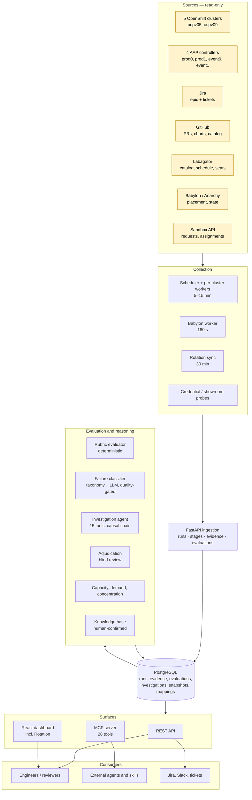
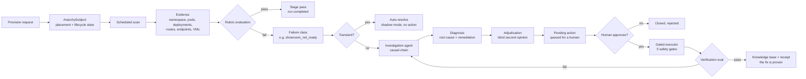
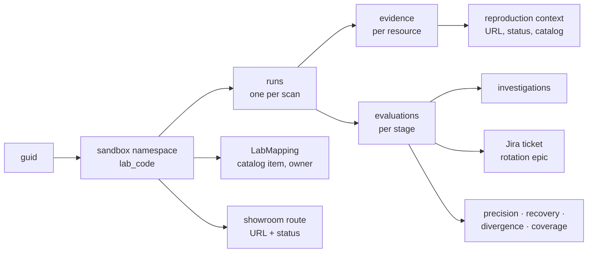
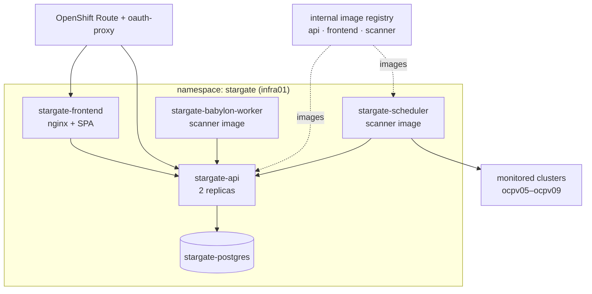

# StarGate — diagrams

Canonical, renderable diagrams (Mermaid, supported by GitHub and the Confluence
Mermaid macro). `docs/architecture.md` and `docs/workflows.md` embed the first
two; this file holds the full set, including the identity model.

---

## 1. Architecture

**Boundary:** StarGate holds a read-only `cluster-reader` credential and never
reads Secrets. Credential verification is an external, time-boxed audit that
posts counts and hashes only.

---

## 2. Event workflow — detect → classify → investigate → verify

---

## 3. Identity and joins

The three identifiers that make cross-source questions possible — and the
reason lab-level features need `lab_code` rather than run namespace.

**Join keys:** `lab_code` (property), `run_id` (scan), `evidence.run_id`
(observations), `credential sha256[:16]` (values, never stored), `guid`
(provisioning identity).

---

## 4. Deployment topology

